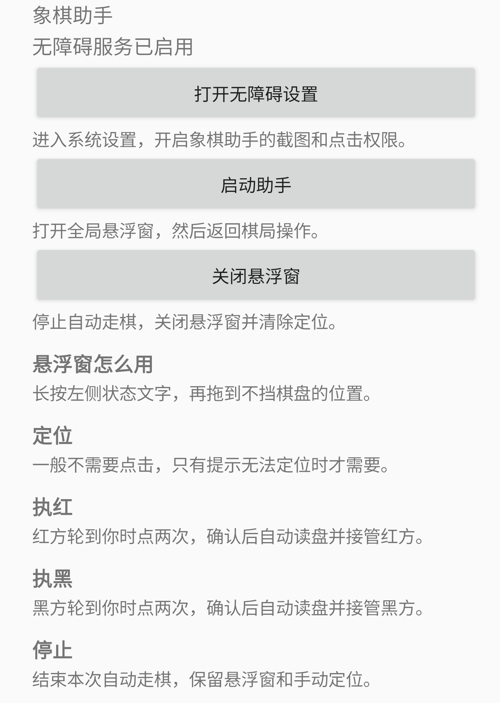
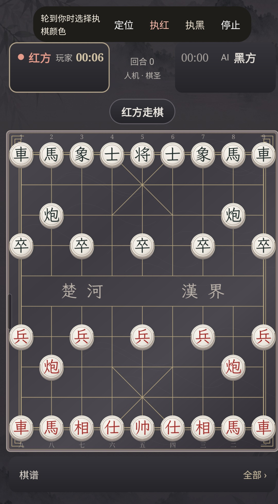
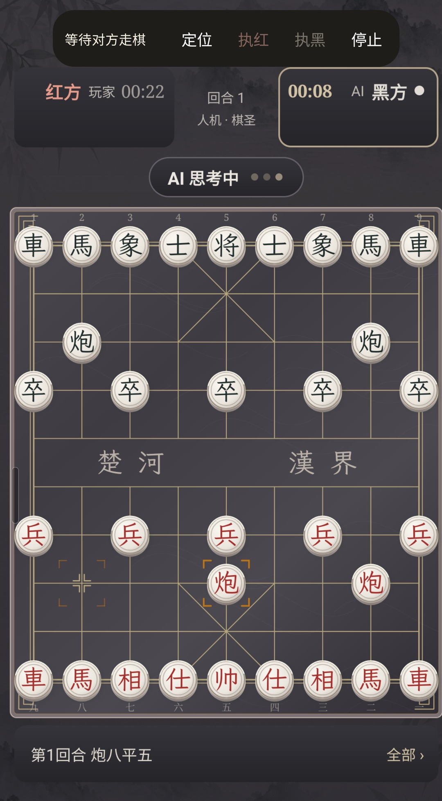
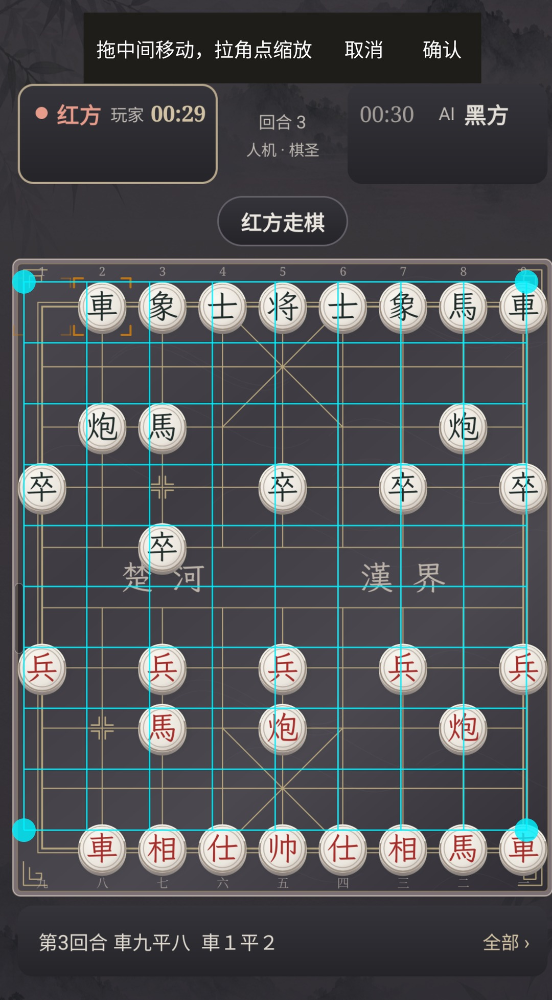
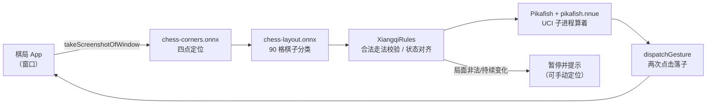

<div align="center">

# 象棋助手 · XiangqiBridge

**让手机自己下棋**：无障碍截图 → ONNX 读盘 → Pikafish(NNUE) 算着 → 无障碍手势落子

-3DDC84?logo=android&logoColor=white)


</div>

## 简介

象棋助手是一个**免 root** 的 Android 中国象棋盘面自动识别 + 自动落子应用。它用无障碍服务截取棋局窗口，两个轻量 ONNX 模型完成「棋盘四点定位 + 90 格棋子分类」，内置 Pikafish 引擎（NNUE 权重随 APK 分发）在手机本地算出最佳着法，最后通过无障碍手势点击完成落子。

全程离线运行，不联网、不注入目标应用、不读写其他进程内存——只是"替你看一眼屏幕，替你点两下"。

- 适用场景：人机对局、练习模式、残局推演
- 实测设备：Galaxy S24 Ultra（SM-S9280）/ Android 16 / 1440×3120 / 600 dpi —— 下图即真实运行截图，第 1 回合自动走出「炮八平五」

## 截图

| 主界面 | 悬浮控制条 |
|:---:|:---:|
|  |  |
| **自动对局中**：读盘完成、已落子、等待对方 | **手动定位**：拖动/缩放校准棋盘四点 |
|  |  |

## 特性

| 能力 | 说明 |
|:---|:---|
| 自动定位棋盘 | 角点回归模型输出 4 点 → 换算 9×10 网格；失败时可手动拖动/缩放微调 |
| 90 格棋子识别 | 单次前向 90 个 softmax，14 类（空点 + 红黑各 7 兵种），带置信度间隔阈值 |
| 合法走法校验 | 内置完整中国象棋规则：只接受「恰好两格变化」且为合法着法的帧，杜绝误识别导致的乱走 |
| 本地强引擎 | Pikafish + NNUE，UCI 子进程，`movetime 450`，Threads 2 / Hash 32MB |
| 无注入落子 | `dispatchGesture` 双点（起手 130ms、点按 45ms），不 hook、不改包 |
| 遮挡保护 | 逐窗口比较 layer，棋局被悬浮窗/系统面板遮挡时自动暂停 |
| 全局悬浮控制 | 无障碍悬浮层，长按可拖动；不抢焦点、不挡棋盘 |
| 双帧确认 | 同一盘面连续两帧一致才行动，避免动画/过渡帧触发误判 |

## 工作流程



## 快速开始

### 环境要求

- JDK 17+
- Gradle 9.x（AGP 9.2.1；本仓库未附 Wrapper，见「已知问题」）
- Android SDK：`compileSdk 36` / `minSdk 34` / `targetSdk 36`
- 设备：arm64-v8a，Android 14+

### 构建安装

```bash
gradle :app:assembleDebug
adb install -r app/build/outputs/apk/debug/app-debug.apk
```

> Debug APK 约 **96 MB**，主要是三个随包模型（见「体积与性能」）。

### 使用步骤

1. 打开 App →「打开无障碍设置」→ 找到「象棋助手」→ 开启服务（允许 **截图** 与 **点击手势**）
2. 回到 App 点「启动助手」，屏幕顶部出现悬浮控制条，然后切到棋局
3. 轮到你走棋时，**点两次「执红」**（执黑同理）确认接管
4. 助手自动：读盘 → 算棋 → 落子 → 等待对方回着，循环往复
5. 点「停止」结束本次自动走棋（保留悬浮条与定位）；「关闭悬浮窗」彻底退出
6. 悬浮条拖动：长按左侧状态文字，再拖到不挡棋盘的位置

## 项目结构

```
.
├── app/
│   ├── build.gradle.kts                  # AGP 9.2.1 / minSdk 34 / 仅 arm64-v8a
│   └── src/
│       ├── main/
│       │   ├── AndroidManifest.xml        # Activity + AccessibilityService 声明
│       │   ├── assets/
│       │   │   ├── chess-corners.onnx     # 10.2 MB  棋盘四点定位（RTMPose 结构）
│       │   │   ├── chess-layout.onnx      # 29.7 MB  90 格棋子分类
│       │   │   └── pikafish.nnue          # 48.4 MB  Pikafish NNUE 权重
│       │   ├── java/local/chessbridge/
│       │   │   ├── MainActivity.kt        # 配置界面（纯代码构建 UI，无 XML 布局）
│       │   │   ├── ChessService.kt        # 核心状态机：截图→识别→算棋→落子
│       │   │   ├── OnnxBoard.kt           # ONNX 推理：定位 + 读盘
│       │   │   ├── PhoneEngine.kt         # Pikafish UCI 子进程封装
│       │   │   ├── XiangqiRules.kt        # 走法生成/校验/局面对齐
│       │   │   ├── Board.kt               # 盘面/标定数据结构
│       │   │   └── PracticeOverlay.kt     # 悬浮控制条 + 手动定位面板
│       │   ├── jniLibs/arm64-v8a/
│       │   │   └── libpikafish.so         # 1.7 MB  引擎可执行文件（伪装成 .so 便于打包）
│       │   └── res/xml/accessibility.xml  # 无障碍能力声明
│       └── test/java/local/chessbridge/
│           └── XiangqiRulesTest.kt        # 规则引擎单元测试
├── docs/                                  # README 配图（真机截图，已裁剪）
│   ├── 01-main.png
│   ├── 02-overlay.jpg
│   ├── 03-autoplay.jpg
│   └── 04-calibrate.jpg
├── LICENSE                                # GPL-3.0
├── settings.gradle.kts
└── README.md
```

## 实现细节

### 1. 棋盘定位：模型粗定位 + 手动兜底

`OnnxBoard.locate()` 把窗口截图按 1.25 倍外扩后居中缩放到 256×256，取模型两组 512-bin 热图（x / y 各 4 点）的 argmax，反算回原图坐标；`rectangularGrid()` 再做强约束过滤：

- 单格宽 ≥ 10 px，且 `stepY / stepX ∈ 0.7..1.4`（象棋盘 9 列 10 行，近似正方格）
- 四个点必须在图内，且同边两点的错位 < 半个格宽
- 任一条不满足即判定位失败，回落到「点定位微调」的青色网格手工校准

### 2. 读盘：90×14 分类 + 双阈值

把标定后的棋盘仿射到 280×315（每格 35×35，外扩 17.5 px），一次性输出 90 格 × 14 类的分数。逐格取 top-1，同时要求：

- `top1 - top2 ≥ 0.35`，否则整帧作废（模糊、遮挡、动画中）
- top-1 为「未知」类也作废
- 结果交给 `Board.plausible()` 做数量校验：将/帅各 1、车马炮各 2、士象各 2、兵卒各 5，且将帅必须在九宫内

### 3. 局面一致性：只认「一步合法变化」

`XiangqiRules.reconcile(before, observed)` 要求两帧之间**恰好两个格子变化**，且能由一条合法着法解释（含将帅照面、马腿、象眼、塞象心、过河兵横走等全部规则），否则判为误识别：

- 变化帧数不对 → 丢弃
- 连续 2.6 s 无法解释 → 暂停并提示重新确认
- 本方走子后进入 `expected` 状态，最多等 5.5 s 确认落子，超时即中止

### 4. 引擎：UCI 子进程

`PhoneEngine` 首次使用时把 `assets/pikafish.nnue` 复制到 `filesDir`（引擎只能吃真实文件路径），再从 `nativeLibraryDir` 启动 `libpikafish.so`（`useLegacyPackaging = true` 保证它被解压且可执行），随后 `uci → setoption EvalFile → Threads 2 → Hash 32 → isready`，每步 `go movetime 450`。

### 5. 落子：双点手势

把引擎着法（如 `h2e2`）换算成棋盘上的两个交点坐标，一次 `GestureDescription` 内放两段 stroke（第二段延后 130 ms，各 45 ms），等效"点起手 → 点落点"。发送前再查一次窗口是否被遮挡，避免点到悬浮窗上。

### 6. 遮挡检测

`unobstructed()` 遍历所有窗口，凡 `layer` 高于棋局窗口且与棋盘矩形相交的，一律视为遮挡；唯一例外是收起的系统侧边把手（窄条且贴在棋盘最外侧一列），只要落子点不在其上就放行——这是三星等机型上必须的特判。

## 已知问题

- **思考超时定时器未取消**：`ChessService.think()` 每手都排一个 12 s 的超时任务，成功出招后没有 cancel。极端情况（局面重复且间隔较久）可能被上一手的陈旧任务误判为「手机算棋超时」，建议改为持有 `ScheduledFuture` 并在拿到 bestmove 时取消。
- **停止即杀引擎**：`stop()` 无条件 `close()` 引擎进程，一次识别抖动就要重新加载 48 MB 权重。建议区分「用户主动停止」与「异常中断」。
- **重复校验**：`OnnxBoard.read()` 已做 `plausible()`，`ChessService.observe()` 又经 `validSeed()` 再算一遍（每帧两次全盘计数）。
- **每帧分配**：`tensor()` 每次新建 `FloatArray`（约 1 MB）与临时 Bitmap，可持续运行但带来额外 GC 压力。
- **未附 Gradle Wrapper**：需要本机安装 Gradle 9.x 才能构建，或自行 `gradle wrapper` 生成。
- **仅 arm64-v8a**：为控制体积砍掉了 32 位与 x86，模拟器需用 arm64 镜像。

## 体积与性能

| 组成 | 大小 |
|:---|---:|
| `pikafish.nnue` | 48.4 MB |
| `chess-layout.onnx` | 29.7 MB |
| `libonnxruntime.so`（arm64） | 18.5 MB（压缩后 7.2 MB） |
| `chess-corners.onnx` | 10.2 MB |
| `libpikafish.so` + dex + 资源 | ≈ 4.3 MB |
| **Debug APK** | **≈ 96 MB** |

- 首次启动会把 NNUE 复制到 `filesDir`，设备上会短暂存在两份权重（约 48 MB）
- 单次读盘：2 次 ONNX 前向（定位仅在自动定位时跑一次）+ 1 次 90 格分类
- 单步耗时：截图 ~150 ms、推理 ~200 ms、算棋 450 ms、手势 ~180 ms
- 轮询周期 360 ms，实际按「截图 → 等待稳定双帧 → 决策」约 1.2 s 一帧推进

## 第三方组件与许可

| 组件 | 用途 | 许可 |
|:---|:---|:---|
| [Pikafish](https://github.com/official-pikafish/Pikafish) | 中国象棋引擎（`libpikafish.so` + `pikafish.nnue`） | GPL-3.0 |
| [ONNX Runtime](https://github.com/microsoft/onnxruntime) | 端上推理（`onnxruntime-android`） | MIT |
| `chess-layout.onnx` / `chess-corners.onnx` | 棋盘定位与棋子分类，由桌面端识别项目导出的 RTMPose 结构模型 | 随本仓库分发 |

本项目因随包分发 Pikafish（GPL-3.0）二进制与权重，整体以 **GPL-3.0** 发布，完整许可文本见 [LICENSE](LICENSE)。若分发自行修改的版本，请同样保留许可与源码可得性。
